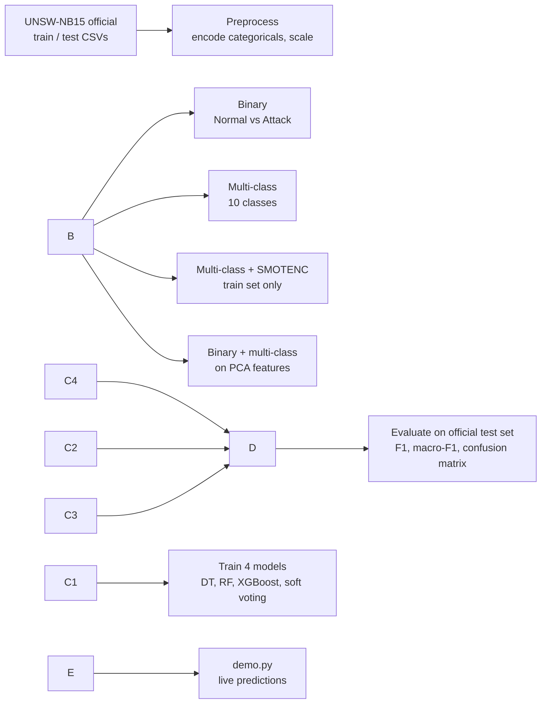

# Cyber Attack Detection Using Ensemble Learning

Network intrusion detection on the **UNSW-NB15** benchmark. A baseline Decision Tree is compared against three ensemble methods (**Random Forest**, **XGBoost**, and a **soft-voting ensemble**) on binary attack detection and 10-class attack-type classification, with two extra experiments: **SMOTE** oversampling and **PCA** dimensionality reduction. Evaluation uses the dataset authors' official train/test partition, which is deliberately harder than a random split.

!\[Python](https://img.shields.io/badge/python-3.12%20tested-blue) !\[License](https://img.shields.io/badge/license-MIT-green)

## Highlights

* **Ensembles beat the single tree** on every metric in both binary and multi-class tasks. XGBoost was best overall: **89.6% binary F1** and **0.50 macro-F1** on 10 classes.
* **Few real attacks slip through in binary mode:** recall stays at or above 98% for all four models.
* **Multi-class is much harder than binary.** Large classes (Generic, Reconnaissance, Normal) score F1 0.85 to 0.98, but rare ones (Analysis, Backdoor, DoS) score 0.06 to 0.14, mostly mislabelled as Exploits.
* **SMOTE did not help.** It raised recall on rare classes but cut precision by more, so macro-F1 fell for all four models. This was measured, not assumed, including a check at three oversampling levels (see below).
* **PCA hurt too.** Reducing 42 features to 22 principal components lowered every model's score and gave no meaningful speed-up. Raw features suit tree ensembles better here.
* **The voting ensemble did not beat its best member** (XGBoost). Averaging in weaker models diluted the stronger one.

!\[Results overview](docs/results\_overview.png)

*Note: y-axes in the left two panels are truncated to make small gaps visible; the real differences between models are small.*

## Results

All numbers are on the official UNSW-NB15 test set (82,332 records), single run with a fixed random seed.

### Binary: Normal vs Attack

|Model|Accuracy|Precision|Recall|F1|
|-|-|-|-|-|
|Decision Tree|84.39%|78.71%|98.22%|87.39%|
|Random Forest|86.47%|80.81%|98.92%|88.95%|
|**XGBoost**|**87.39%**|82.04%|98.69%|**89.60%**|
|Voting Ensemble|86.62%|81.12%|98.66%|89.04%|

Precision (about 79 to 82%) is lower than recall because the official test set has a different class mix than training (55% attack vs 68%), so models flag more normal traffic as attacks.

### Multi-class: 10 classes (Normal + 9 attack types)

|Model|Accuracy|Macro-F1|Weighted-F1|
|-|-|-|-|
|Decision Tree|70.31%|0.443|0.729|
|Random Forest|76.76%|0.473|0.774|
|**XGBoost**|**76.91%**|**0.502**|0.780|
|Voting Ensemble|75.65%|0.471|0.770|

**Macro-F1** averages every class equally, so it exposes rare-class performance. It is the headline metric here. Accuracy and weighted-F1 are dominated by the big classes.

Per-class results for XGBoost (best model):

|Class|Precision|Recall|F1|Test rows|F1 with SMOTE|
|-|-|-|-|-|-|
|Generic|1.00|0.97|0.98|18,871|0.98|
|Reconnaissance|0.93|0.81|0.87|3,496|0.87|
|Normal|0.97|0.76|0.85|37,000|0.84|
|Exploits|0.59|0.86|0.70|11,132|0.70|
|Fuzzers|0.32|0.61|0.42|6,062|0.41|
|Shellcode|0.30|0.75|0.43|378|0.32|
|Worms|0.72|0.41|0.52|44|0.21|
|DoS|0.50|0.08|0.14|4,089|0.12|
|Backdoor|0.04|0.10|0.06|583|0.09|
|Analysis|0.05|0.06|0.06|677|0.05|

!\[Confusion matrix](docs/confusion\_matrix\_multiclass\_xgboost.png)

*Row-normalised: each row shows where the true class was predicted. The Exploits column absorbs most DoS, Analysis, Backdoor and Worms traffic.*

### Multi-class with SMOTE

Training classes with fewer than 10,000 rows (Analysis, Backdoor, Shellcode, Worms) were oversampled to 10,000 using **SMOTENC**. The test set was never resampled.

|Model|Macro-F1, no SMOTE|Macro-F1, SMOTE|Macro-recall, no SMOTE|Macro-recall, SMOTE|
|-|-|-|-|-|
|Decision Tree|0.443|0.398|0.484|0.558|
|Random Forest|0.473|0.445|0.502|0.606|
|XGBoost|0.502|0.458|0.541|0.603|
|Voting Ensemble|0.471|0.444|0.508|0.594|

* Recall rose but precision fell by more. For Worms, recall went from 0.41 to 0.80 while precision dropped from 0.72 to 0.12.
* DoS was not touched (it already had 12,264 rows). Its problem is overlap with Exploits, not too few examples.
* A sensitivity check on XGBoost with floors of 3,000 / 5,000 / 10,000 rows gave macro-F1 of 0.488 / 0.470 / 0.458 (0.502 without SMOTE): the more oversampling, the worse.
* If missing a rare attack is costlier than a false alarm, the higher-recall SMOTE models could still be the better choice.

### PCA (dimensionality reduction)

PCA was fit on the scaled training data only and keeps the fewest components that explain 95% of the variance: **42 features became 22 components** (95.6% of variance). The 95% threshold was fixed in advance, not tuned on test results.

!\[PCA explained variance](docs/pca\_explained\_variance.png)

**Binary**

|Model|F1, raw|F1, PCA|Precision, raw|Precision, PCA|Recall, raw|Recall, PCA|
|-|-|-|-|-|-|-|
|Decision Tree|0.874|0.854|0.787|0.750|0.982|0.991|
|Random Forest|0.890|0.866|0.808|0.769|0.989|0.990|
|XGBoost|0.896|0.869|0.820|0.776|0.987|0.987|
|Voting Ensemble|0.890|0.863|0.811|0.765|0.987|0.990|

**Multi-class**

|Model|Macro-F1, raw|Macro-F1, PCA|Accuracy, raw|Accuracy, PCA|
|-|-|-|-|-|
|Decision Tree|0.443|0.337|70.3%|70.9%|
|Random Forest|0.473|0.402|76.8%|72.5%|
|XGBoost|0.502|0.404|76.9%|72.3%|
|Voting Ensemble|0.471|0.382|75.7%|72.4%|

* **PCA lowered performance for every model.** Binary F1 fell by 2 to 3 points; multi-class macro-F1 fell by 0.07 to 0.11 (XGBoost 0.502 to 0.404).
* **No meaningful speed-up.** Prediction time on the 82,332-row test set (seconds, single CPU core, noisy; differences between runs are mixed in direction) barely changed. Training was slower for the tree models, e.g. Random Forest about 22s to 56s on the binary task:

|Model|Binary, raw|Binary, PCA|Multi-class, raw|Multi-class, PCA|
|-|-|-|-|-|
|Decision Tree|0.01|0.01|0.01|0.01|
|Random Forest|0.45|0.53|0.58|0.73|
|XGBoost|0.11|0.11|1.08|1.39|
|Voting Ensemble|0.59|0.73|1.85|2.13|

* **Likely reasons:** PCA is unsupervised, so it keeps high-variance directions rather than class-informative ones (the leading components are driven by volume and window features such as `dwin`, `dpkts`, `sbytes`). Trees also work best on individual raw features, and the discarded 5% of variance can hold subtle patterns that separate rare attack classes.
* Which original features drive each component is saved in `artifacts/pca/top\_features\_per\_component.csv`.
* For tree ensembles on this dataset, raw features are the better choice.

## Approach



**Models**

|Model|Type|Settings|
|-|-|-|
|Decision Tree|single model (baseline)|max depth 10|
|Random Forest|bagging|100 trees, max depth 15|
|XGBoost|boosting|100 rounds, depth 6, learning rate 0.1|
|Voting Ensemble|soft voting over the three above|averaged class probabilities|

**Preprocessing and leakage control**

* Official train/test files are used as published, not re-split.
* `proto`, `service`, `state` are label-encoded. The encoder vocabulary is built from train and test together because the test set contains `state` values (`CLO`, `ACC`) never seen in training. This uses no labels.
* `StandardScaler` is fit on training data only.
* SMOTENC (not plain SMOTE, since three features are category codes) runs on the training set only, before scaling, and the original scaler is reused.
* PCA is fit on the scaled training set only and then applied to the test set.

## Quick start

```bash
git clone https://github.com/aishi10/ML_Project.git
cd ML_Project
pip install -r requirements.txt
```

1. Download the two UNSW-NB15 partition CSVs into `data/` (see [data/README.md](data/README.md)).
2. Train (models are not stored in the repo):

```bash
python train\_pipeline.py                          # all five tasks (10 to 15 minutes, depends on CPU)
python train\_pipeline.py --task multiclass        # one task only (also: binary, multiclass\_smote, binary\_pca, multiclass\_pca)
```

3. Try live predictions on held-out test traffic:

```bash
python demo.py --random 5                         # multi-class, 5 random samples
python demo.py --task binary --random 5           # Normal vs Attack
python demo.py --task multiclass\_smote --index 42 # SMOTE-trained models, specific row
python demo.py --task binary\_pca --random 5       # models trained on PCA features
python demo.py --model random\_forest              # choose a model
```

4. Or use the web app (same models, in the browser):

```bash
streamlit run app.py
```

It has three tabs: **Try a sample** (pick or randomise a held-out test row and see the prediction with class probabilities), **Batch upload** (upload a CSV of raw UNSW-NB15 rows, get predictions and download them) and **Model results** (saved metric tables, confusion matrix and PCA plot). Use the sidebar to switch task and model.

The notebook `Cyber\_Attack\_Detection.ipynb` walks through the whole pipeline and is committed with its outputs.

### Example demo output

```
Task: multiclass | Model: XGBoost
--------------------------------------------------------------
Key traffic features:
    dur        : 0.674665
    proto      : tcp
    service    : -
    state      : FIN
    sbytes     : 564
    dbytes     : 354
    sttl       : 254
    rate       : 25.197692

  PREDICTION : RECONNAISSANCE
  Top 3      : Reconnaissance 98.8%   Normal 0.4%   Shellcode 0.3%
  Actual     : RECONNAISSANCE   \[CORRECT]
--------------------------------------------------------------
```

A miss, shown for honesty (a DoS record labelled Exploits with low confidence):

```
  PREDICTION : EXPLOITS
  Top 3      : Exploits 47.2%   DoS 26.5%   Reconnaissance 13.1%
  Actual     : DOS   \[WRONG]
```

## Repository layout

```
.
├── Cyber\_Attack\_Detection.ipynb   executed walkthrough (binary, multi-class, SMOTE, PCA)
├── train\_pipeline.py              training + evaluation for all tasks
├── demo.py                        live prediction demo (command line)
├── app.py                         Streamlit web app (browser demo)
├── requirements.txt
├── data/                          put the UNSW-NB15 CSVs here (not committed)
├── artifacts/                     generated: result tables and plots committed, models ignored
└── docs/                          figures used in this README
```

## Limitations

* **Single run, fixed seed, no cross-validation.** Gaps of about one F1 point between ensembles (for example XGBoost vs Voting vs Random Forest in binary) may be within run-to-run noise. The gap between ensembles and the single Decision Tree is larger and more reliable.
* **No hyperparameter tuning.** All models use reasonable defaults.
* **Timings are rough.** Prediction times come from one run on a single CPU core and vary from run to run.
* **Distribution shift.** The official test set differs from training by design, so scores are lower than a random split would give (a random 80/20 split of the training file gave binary F1 around 0.97, which would overstate real-world performance).
* **Flow-level features on one dataset.** Nothing here was tested on live traffic or on other datasets, and the dataset dates from 2015.
* **Rare attack types remain poorly detected.** Analysis, Backdoor and DoS are close to unusable in the 10-class setting.

## Possible extensions

* Cost-sensitive learning (class weights) or other imbalance methods compared against SMOTE
* PCA with one-hot encoded categoricals, or supervised feature selection (e.g. mutual information) instead of PCA
* Hyperparameter search and repeated runs / cross-validation for confidence intervals
* Evaluation on a second dataset such as CIC-IDS2017
* **SDN-specific DDoS detection.** Repeat the PCA + ensemble pipeline on a real SDN DDoS dataset (OpenFlow switch/flow statistics such as packet and byte counts, flow rates and per-port throughput), where DDoS is the target rather than one class among ten. The UNSW-NB15 results above are a related but different setting: DoS is its hardest class here (XGBoost recall about 0.08 in the 10-class task), so DoS/DDoS-focused detection would need dedicated features or a dedicated dataset.
* Feature-level explanations (for example SHAP) for why a connection was flagged

## References

1. Moustafa, N., \& Slay, J. (2015). UNSW-NB15: a comprehensive data set for network intrusion detection systems. *Military Communications and Information Systems Conference (MilCIS)*.
2. Breiman, L. (2001). Random Forests. *Machine Learning, 45*(1), 5-32.
3. Chen, T., \& Guestrin, C. (2016). XGBoost: A scalable tree boosting system. *KDD*.
4. Chawla, N. V., et al. (2002). SMOTE: Synthetic Minority Over-sampling Technique. *Journal of Artificial Intelligence Research, 16*, 321-357.

## License

Code is released under the MIT License (see [LICENSE](LICENSE)). The UNSW-NB15 dataset has its own terms; cite the authors if you use it.

